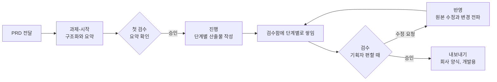

# 02. 서비스 구조 설계

- 작성일: 2026-11-20
- 상태: 초안
- 관련 문서: `01_요구사항_정의서.md`

## 1. 개요

서비스는 **서비스 본체(플러그인)**와 **기획자 작업 공간(폴더)** 두 부분으로 나뉩니다. 서비스 본체는 모든 기획자가 같은 것을 설치해 쓰고, 작업 공간에는 기획자 각자의 회사 컨텍스트와 과제가 쌓입니다. 기획자는 Claude Code 데스크톱 앱에서 작업 공간 폴더를 열고, 대화나 명령으로 서비스를 씁니다.

| 구분 | 내용 | 누가 바꾸나 |
|---|---|---|
| 서비스 본체 (플러그인) | 공통 지침, 단계별 모듈, 템플릿, 점검 기준, 파일 생성 도구 | 서비스 개발자 (업데이트로 배포) |
| 작업 공간 (폴더) | 회사 컨텍스트, 과제별 입력과 산출물, 검수함, 결정 기록 | 서비스가 만들고 기획자가 검수 |

서비스 본체 중 단계 지침, 템플릿, 점검 기준, 파일 생성 스크립트는 **엔진**으로 묶고 표준 스킬 형식으로 만듭니다. 엔진은 Claude Code에 묶이지 않아, 나중에 웹 앱으로 서비스화할 때 Claude Agent SDK에서 그대로 재사용합니다. Claude Code에만 있는 기능(훅, 로컬 폴더)은 엔진 밖에 둡니다.

## 2. 작업 공간 폴더 구조

```
기획 작업 공간/
├─ 회사/                          회사 컨텍스트 (FR-001~006)
│  ├─ 규칙.md                     업무 프로세스, 작성 기준, 정책, 용어집 (승인된 것만)
│  ├─ 원본_위치.md                 읽은 회사 폴더 경로와 문서 목록
│  ├─ 양식/                       회사 산출물 양식 파일 (화면 설계서.pptx 등)
│  └─ 화면지도/                    서비스별 현행 화면 지도
│
└─ 과제/
   └─ 2026-11-20_로그인_정책_개선/   과제 하나 = 폴더 하나
      ├─ 과제요약.md               PRD 구조화 결과, 과제 유형, 진행 단계와 상태
      ├─ 검수함.md                 검수 대기 중인 요약, 결정 필요 항목, 확인 항목
      ├─ 결정기록.md               모든 결정과 이유
      ├─ 입력/                     기획자가 준 PRD와 참고 자료 (원본 그대로)
      ├─ 원본/                     단계별 산출물 원본 (마크다운)
      │  ├─ 01_영향분석.md
      │  ├─ 02_유저플로우.md
      │  ├─ 03_와이어프레임/
      │  ├─ 04_기능명세_정책.md
      │  ├─ 05_수용기준.md
      │  └─ 06_개발태스크.md
      ├─ 회사양식/                  원본에서 생성한 회사 양식 파일 (.pptx, .docx)
      └─ 개발용/                    원본에서 생성한 AI 개발용 파일
```

- 회사 폴더의 문서는 복사하지 않고 원래 위치에서 읽습니다. 복사하는 것은 산출물 양식 파일뿐입니다.
- 과제 폴더 이름은 날짜와 과제명으로 자동 생성합니다.
- `원본/` 안의 단계 번호는 과제에서 진행하는 단계 순서대로 붙습니다. 과제 유형에 따라 일부 단계가 빠질 수 있습니다.

## 3. 산출물 원칙: 원본 하나, 생성물 둘

```
원본/ (마크다운)  ──생성──▶  회사양식/ (.pptx, .docx)   → 구성원에게 전달
                 └─생성──▶  개발용/ (구조화 텍스트)     → 개발자, AI 코딩 도구에 전달
```

- **기준은 원본 하나입니다.** 원본에는 구성원용 설명(배경, 의도)과 개발용 명세(ID, 조건, 값, 예외)가 함께 들어 있습니다. 두 생성물은 원본에서 만들어지므로 내용이 항상 일치합니다 (FR-040).
- **기획자는 어디서 고치든 신경 쓰지 않아도 됩니다.** 원본을 직접 열 필요도 없습니다.

### 3.1 고치는 두 가지 길

| 고치는 곳 | 서비스가 하는 일 | 기획자에게 보이는 것 |
|---|---|---|
| 대화 (기본) | 예: "SCR-010 버튼 문구 바꿔 줘". 원본을 고치고, ID 연결로 영향받는 항목을 함께 고친 뒤 생성물을 다시 만듦 (FR-044) | 바뀐 결과 |
| 회사 양식 파일 직접 수정 | 다음 대화 때 바뀐 파일을 자동으로 감지해 바뀐 부분을 원본에 반영하고, 개발용을 다시 만듦 | 한 줄 알림. 예: "화면 설계서 3장 수정 사항을 반영했어요." |

**충돌할 때만 묻습니다.** 같은 항목이 원본(대화로 수정)과 회사 양식 파일 양쪽에서 다르게 바뀐 경우에만 어느 쪽을 쓸지 묻습니다. 회사 양식 파일에서 직접 고친 내용은 반영하기 전에 덮어쓰지 않습니다.

### 3.2 자동 감지 방식

1. 생성할 때 회사 양식 파일마다 지문(파일 해시)과 생성 시각을 `과제/<과제>/.생성기록.json`에 남깁니다.
2. 기획자가 요청을 보낼 때마다 Claude Code 훅이 Python 스크립트를 실행해 지문을 비교합니다. 따로 켜 둘 프로그램은 없습니다.
3. 바뀐 파일이 있으면 스크립트가 파일 내용을 읽어 항목 ID별로 이전 생성 내용과 비교합니다.
4. 서비스가 바뀐 항목을 원본에 반영하고, 영향받는 다른 항목과 개발용 파일을 함께 고칩니다.

**조건**
- 회사 양식 파일의 장표나 표마다 `SCR-010` 같은 ID를 표시합니다 (FR-042). ID가 없는 곳의 수정은 가장 가까운 항목에 반영하고 알림에 표시합니다.
- 기획자가 파일을 연 채로 저장하지 않았으면 감지되지 않습니다. 저장한 내용만 반영합니다.

## 4. 명령 구성

기획자는 명령을 외우지 않아도 됩니다. 대화로 요청하면 서비스가 알맞은 명령을 실행합니다. 명령은 자주 쓰는 일을 빠르게 하기 위한 단축키입니다.

| 명령 | 하는 일 | 관련 요구사항 |
|---|---|---|
| `/회사-익히기` | 회사 폴더를 읽고 규칙과 양식을 정리해 검수받음. 처음 한 번, 이후 필요할 때 | FR-001~003 |
| `/화면지도` | 캡처, 기획서, 피그마, 코드로 현행 화면 지도를 만들거나 갱신 | FR-004~006 |
| `/과제-시작` | PRD를 받아 과제 폴더를 만들고, 구조화와 요약을 거쳐 첫 검수를 받음 | FR-010~013, FR-020 |
| `/진행` | 남은 단계를 순서대로 작성. 단계마다 검수함에 올리고 멈추지 않고 다음 단계로 진행 | FR-021~025, FR-032 |
| `/검수` | 검수함의 대기 항목을 보여 주고 승인, 결정, 수정 요청을 받음 | FR-030~033 |
| `/반영` | 추가 자료, 회의 결과를 원본에 반영하고 영향받는 산출물을 함께 고침. 직접 고친 회사 양식 파일은 자동 감지되므로 이 명령이 필요 없음 | FR-014, FR-043, FR-044 |
| `/내보내기` | 원본에서 회사 양식과 개발용 파일을 다시 생성 | FR-040, FR-041 |
| `/현황` | 과제별 진행 단계와 검수 대기 상태를 보여 줌 | |
| `/모드` | 위임 모드와 코칭 모드 전환 | FR-035, FR-036 |

명령 이름은 개발할 때 Claude Code에서 쓸 수 있는 형식에 맞춰 최종 확정합니다.

## 5. 한 과제의 흐름



| 순서 | 서비스가 하는 일 | 기획자가 하는 일 |
|---|---|---|
| 1 | | PRD와 참고 자료를 전달하고 과제 시작을 요청 |
| 2 | PRD를 구조화하고 1페이지 요약(과제 유형, 핵심 기능, 진행 단계, 가정)을 만듦. 상세 기획을 막는 빈 곳만 질문 | 요약 확인, 질문에 답함 |
| 3 | 단계별 산출물을 작성하고 자가 점검 후 검수함에 올림. 결정 필요 항목은 추천안을 가정으로 적용해 계속 진행 | 기다리지 않아도 됨 |
| 4 | 검수함 대기 항목을 단계별로 보여 줌 | 단계별로 또는 묶어서 검수 |
| 5 | 수정 요청과 결정을 원본에 반영하고, 영향받는 다른 산출물도 함께 고침 | 바뀐 결과 확인 |
| 6 | 회사 양식 파일과 개발용 파일을 생성 | 구성원과 개발에 전달 |

첫 검수(PRD 요약 확인)만 진행 전에 승인받습니다. 이후 모든 산출물의 기준이 되기 때문입니다.

## 6. 검수 방식

검수는 과제 폴더의 `검수함.md`에 단계별로 쌓입니다. 기획자는 `/검수`로 대화에서 보거나 파일을 직접 열어 봅니다. 답은 대화로 하면 됩니다 (예: "유저플로우 승인, 결정 1번은 B").

**검수함 예시**

```markdown
## 02 유저 플로우 · 검수 대기

### 요약
- 로그인 실패 5회 시 잠금 대신 추가 인증으로 넘어가는 흐름으로 바꿈
- 영향 화면 3개: 로그인, 추가 인증(신규), 비밀번호 찾기
- 가정 1개: 추가 인증 수단은 휴대폰 인증

### 결정 필요
1. 추가 인증 실패 시 처리
   - A. 30분 잠금: 보안 우선, CS 문의가 일부 남음
   - B. 비밀번호 재설정으로 이동: 문의는 줄지만 단계가 하나 늘어남
   - 추천: B (현재 적용 중인 가정)

### 확인만
- 회사 규칙에 따라 잠금 안내 문구를 기존 문구 체계로 맞춤
- 접근성 기준에 따라 오류 메시지를 입력창 바로 아래에 배치
```

- 검수가 끝난 단계는 `과제요약.md`의 진행 상태에 "검수 완료"로 표시됩니다.
- 결정과 수정 요청은 `결정기록.md`에 남습니다.

## 7. 서비스 본체 구성

| 구성 요소 | 역할 | Claude Code 구현 방식 |
|---|---|---|
| 공통 지침 | 요구사항 정의서 3장의 서비스 공통 원칙 | 작업 공간의 `CLAUDE.md` |
| 명령 | 4장의 명령 | 스킬 (명령으로 호출) |
| 단계 모듈 | 단계마다 하는 일, 입력, 산출물, 점검 기준을 정의 (FR-070) | 단계별 스킬 |
| 템플릿 | 단계별 원본 마크다운 구조 | 스킬에 포함된 템플릿 파일 |
| 점검 기준 | 자가 점검 체크리스트, 업계 기준 (FR-023, FR-024) | 스킬에 포함된 체크리스트 |
| 점검 담당 | 작성한 산출물을 다른 관점에서 다시 점검 | 서브에이전트 |
| 파일 생성 도구 | 원본에서 회사 양식 파일(.pptx, .docx)을 만듦 | 스킬에 포함된 Python 스크립트 |
| 수정 감지 | 회사 양식 파일이 직접 고쳐졌는지 확인하고 바뀐 항목을 찾음 (3.2) | 훅 + Python 스크립트 |

**단계 모듈**은 요구사항 정의서 3.6의 형식(목적, 입력, 산출물, 적용 기준, 검수 지점, 다음 연결)으로 정의합니다. TC 작성, QA 지원 같은 확장 기능은 단계 모듈을 하나 더 추가하는 방식으로 붙입니다.

| 단계 모듈 | 입력 | 산출물 |
|---|---|---|
| 영향 분석 | 과제요약, 화면지도 | `영향분석.md` |
| 유저 플로우 / IA | 과제요약, 영향분석 | `유저플로우.md` |
| 와이어프레임 | 유저플로우 | `와이어프레임/` |
| 기능 명세 / 정책 | 유저플로우, 와이어프레임 | `기능명세_정책.md` |
| 수용 기준 | 기능명세_정책 | `수용기준.md` |
| 개발 태스크 | 수용기준 | `개발태스크.md` |
| (2차) 디자인 시안, 작동 목업, 데이터 / API | | |

## 8. 설치와 배포

1. 기획자가 Claude Code 데스크톱 앱을 설치합니다.
2. 서비스 플러그인을 설치합니다.
3. 빈 폴더를 작업 공간으로 열고 `/회사-익히기`를 실행하면 폴더 구조와 `CLAUDE.md`가 만들어집니다.
4. 서비스가 업데이트되면 플러그인 업데이트로 모든 기획자에게 반영됩니다. 작업 공간의 회사 컨텍스트와 과제는 그대로 유지됩니다.

## 9. 확인 필요 사항

| 항목 | 현재 가정 | 정하는 시점 |
|---|---|---|
| 회사 양식 파일 생성 방식 | Python 스크립트로 회사 양식 파일을 채움. 기획자 PC에 Python 설치 가능 (2026-11-20 확인) | 03 기능 명세서 3.5 |
| 와이어프레임 형식 | 파워포인트 도형으로 그림. 원본은 구성 요소 목록 (03 기능 명세서 5.3) | 시제품 시험 후 |
| 개발용 파일 형식 | 마크다운과 YAML | 수용 기준, 개발 태스크 기능 명세 |
