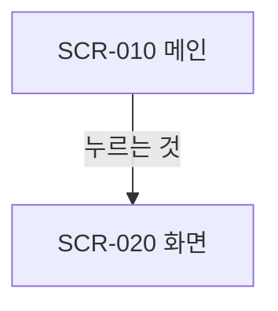

# 유저 플로우 / 메뉴 구조 · v0.1

> 화면을 그리기 전에 정한다. 누가, 어떤 상황에서, 어디로 들어와 무엇을 하고 끝나는지를 먼저 정하고, 그 흐름이 놓일 메뉴 자리를 잡는다. 화면 설계는 이 문서의 "화면 목록"만 그린다.

## 1. 페르소나

서비스 지식의 사용자 유형에서 이 과제를 쓸 사람 2~3명. 지어낸 사실은 쓰지 않고, 서비스 지식과 과제 자료에서 가져온다.

| 페르소나 | 누구인가 (서비스 지식 근거) | 이 기능을 쓰는 상황 | 바라는 것 | 걸림돌 |
|---|---|---|---|---|
| <이름> | <사용자 유형, 특징> | <언제, 어디서, 어떤 상태로> | <한 줄> | <헷갈리거나 귀찮은 점> |

## 2. 핵심 과업

페르소나가 이 기능으로 하려는 일 3~5개. 과업마다 시작(어디서 생각이 나는지)과 끝(무엇이 되면 성공인지)을 쓴다.

| 과업 | 누가 | 시작 | 끝 |
|---|---|---|---|

## 3. 흐름 대안

과업 중 흐름이 갈릴 수 있는 것(진입점, 단계 순서, 화면 하나로 할지 나눌지)마다 2~3개를 비교하고 하나를 고른다.

| | A. <대안> | B. <대안> | C. <대안> |
|---|---|---|---|
| 흐름 | <화면 → 화면 → ...> | | |
| 누름 수 | <n번> | | |
| 찾기 쉬움 | <페르소나가 처음에 어디를 보는가> | | |
| 기존 방식과 맞음 | <서비스의 비슷한 기능은 어떻게 하는가> | | |
| 헷갈림 | <잘못 누르거나 헷갈릴 곳> | | |

**고름: <대안>.** <페르소나와 과업으로 말한 이유 한두 줄>

## 4. 메뉴 구조

기존 메뉴 트리에 이 기능이 놓이는 자리. 바뀌는 곳만 굵게 표시한다. 들어오는 길(진입점)이 여럿이면 모두 쓰고, 화면에 보이는 이름(메뉴, 버튼 문구)을 정한다.

```
하단 탭
├─ <탭>
│  ├─ <화면> (SCR-xxx)
│  │  └─ **<새 항목>** → <화면> (SCR-xxx)
```

| 진입점 | 보이는 이름 | 가는 화면 | 누가 주로 쓰나 |
|---|---|---|---|

## 5. 흐름

고른 대안으로 과업마다 흐름을 그린다. 끝나는 곳(완료, 중단, 실패)을 모두 넣는다.



## 6. 화면 목록

흐름에 나온 화면만. 화면 설계는 이 목록을 그대로 그린다. 목록에 없는 화면이 필요해지면 이 문서를 먼저 고친다.

| 화면 ID | 이름 | 구분 | 과업 | 들어오는 길 |
|---|---|---|---|---|
